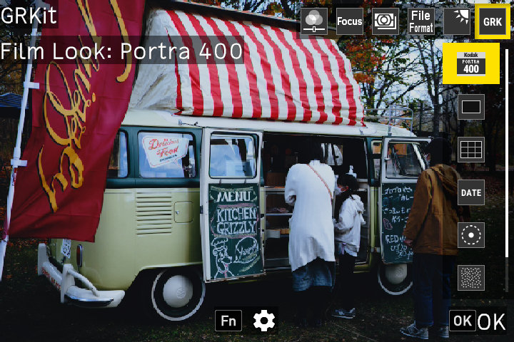
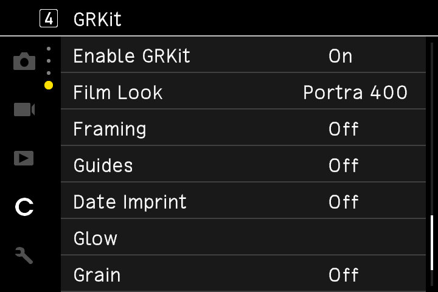

# GRKit

English | [简体中文](README.zh-Hans.md) | [繁體中文](README.zh-Hant.md) | [日本語](README.ja.md) | [한국어](README.ko.md)

[](https://github.com/ahonn/grkit/actions/workflows/tests.yml)
[](LICENSE)

GRKit adds film looks, XPan and other crops, date stamps, glow, and grain to RICOH GR III, GR IIIx, and GR IV. It runs from the SD card and never writes to the firmware. Take the card out and the camera is back to stock.

<p>
  
  
</p>

Photo: [MIKI Yoshihito](https://www.flickr.com/photos/mujitra/53311001084/), [CC BY 2.0](https://creativecommons.org/licenses/by/2.0/).

## Features

Press the ADJ lever while shooting and pick the sixth item, GRK.

- **Film Look**: Portra 400, Velvia 100, Tri-X 400, and more, with a live preview. You can also import your own `.cube` LUT or Lightroom preset on [grkit.app](https://grkit.app). Each look is fitted from an open-source film LUT, so it comes close to the original but isn't identical ([sources](effects/NOTICE.md)).
- **Framing**: XPan, 2.35:1, 16:9, 4:3, 5:4, 7:6, and 1:1. Crop JPEG photos or mark composition only, with a mask or frame lines. Selecting a ratio sets the camera to 3:2 in either mode. Off keeps the camera's current aspect ratio.

  RAW files keep the native 3:2 default crop and the camera's digital crop setting. Embedded previews can still show the selected composition.

- **Guides**: thirds, center, golden ratio, or diagonals.
- **Date Imprint**: the date on the photo in classic, GR1s dot-matrix, or GR II style.
- **Glow**: Bloom softly spreads light around lights and highlights. Halation adds a red-orange halo around bright lights to simulate motion-picture film. Each effect has its own Enable and Strength settings, so both can run together.
- **Grain**: film grain in four strengths and four sizes (Auto, Small, Medium, Large).

GRKit takes about 8 to 10 seconds to load after power-on, and longer on GR IV or on the first start after an install or update. Until then, the camera uses its own settings. All the settings are in the GRKit section at the end of the Customize tab in MENU. To write your own module, see [Writing a module](docs/modules.md).

**Fast start:** with the optional [fast-boot firmware](resources/FASTBOOT.md), the same GRKit package loads soon after power-on. You make it on the [Fast start page](https://grkit.app/fastboot/) of grkit.app from the official Ricoh firmware and install it as a firmware update. GRKit itself never writes to the firmware.

## Supported cameras

| Camera | Tested on a camera | Supported |
| --- | --- | --- |
| GR III, GR III HDF | 2.10, 2.20 | 2.21 |
| GR IIIx, GR IIIx HDF | 1.60, 1.70 | 1.71 |
| GR IV, GR IV HDF | 1.11, 1.20 | 1.21 |
| GR IV Monochrome | 1.00 | 1.10, 1.11 |

GR IV Monochrome has no Film Look. Other models and firmware versions aren't supported. If GRKit doesn't load on a supported camera, see the [firmware dump guide](resources/DUMP.md).

> [!WARNING]
> GRKit is experimental. Use it at your own risk.
> Installing it turns on the camera's SD script setting, which stays on until you turn it off. If GRKit fails, the camera can hang at startup, so read the [recovery guide](resources/RECOVERY.md) first.

## Install

Pick your camera, modules, and effects on [grkit.app](https://grkit.app), then either:

- **Write to the SD card** from Chrome or Edge on a computer. The site can also update or uninstall GRKit and add or remove modules and effects.
- **Download GRKit.zip** and follow the PDF guide inside it ([GR III and GR IIIx](resources/INSTALLATION.md), [GR IV](resources/INSTALLATION-GR4.md)).

The first time only, hold MENU while you turn the camera on. To update from a ZIP, replace the `SCRIPT` folder on the card. Your settings stay in `GRKIT`. Formatting the card removes GRKit, so copy `GRKIT` to a computer first.

If GRK doesn't show up, check the FAQ on [grkit.app](https://grkit.app). If that doesn't help, send `GRKIT/REPORT.TXT`, `GRKIT/BOOT.TXT`, and `SCRIPT/GRKIT/INSTALL.ERR` (if it exists) in a [device report](https://github.com/ahonn/grkit/issues/new?template=device-report.yml).

## Build from source

You need Rust 1.92 or later, Clang and LLD with ARM support, and the official Ricoh firmware file, which this repository doesn't include.

```sh
cargo install --path crates/grkit-cli --locked
grkit effects build --source effects --out build/effects
grkit build --target gr3-2.10 --firmware firmware/fwdc239b.bin --out build/runtime
for module in modules/*/; do grkit module build --dir "$module" --out "build/modules/$(basename "$module").GRM"; done
sh .github/scripts/install-guide-tools.sh build/guide-tools
sh .github/scripts/build-guides.sh grkit build/guide-tools build/guides
grkit package --build build/runtime --effects build/effects $(for m in build/modules/*.GRM; do printf -- '--module %s ' "$m"; done) \
  --guide build/guides/gr3/en.pdf --out dist/GRKit.zip
grkit verify dist/GRKit.zip
```

For other cameras, fewer modules, or other guide languages, see [Build packages](CONTRIBUTING.md#build-packages).

## Contributing

See [CONTRIBUTING.md](CONTRIBUTING.md). Device reports are welcome whether GRKit worked or not, especially for firmware that hasn't been tested on a camera yet. Report problems and ask questions through the [support form](https://tally.so/r/Z9jRgB). Suggest features and vote for the ones you want on the [feedback board](https://grkit.userjot.com). You can also support the project by [buying me a coffee](https://buymeacoffee.com/yuexunjiang).

## Documentation

- [Architecture](docs/architecture.md)
- [Writing a module](docs/modules.md) and the [module reference](docs/module-reference.md)
- [Fast-boot firmware](docs/fastboot.md): the script interface for SD scripts
- [Release process](docs/releasing.md)
- [Effects](effects/README.md)
- [Web site](web/README.md)

## License

The code is under the [MIT License](LICENSE). Each package includes `LICENSES.md` with the licenses of its files.

- The effects are under CC BY-SA 4.0 or MIT. See [effects/NOTICE.md](effects/NOTICE.md).
- The menu and live view text uses [Roboto Condensed](https://github.com/googlefonts/roboto-classic) under the [SIL Open Font License 1.1](crates/grkit-core/assets/RobotoCondensed-LICENSE.txt).
- The effect fitting is ported from [gr3-film-mods](https://github.com/idontknownihil/gr3-film-mods) under the [MIT License](crates/grkit-core/GR3_FILM_MODS_LICENSE.txt).

RICOH and GR are trademarks of Ricoh Company, Ltd. Film names are trademarks of their respective owners. GRKit is an independent project and is not affiliated with Ricoh or any film manufacturer.
