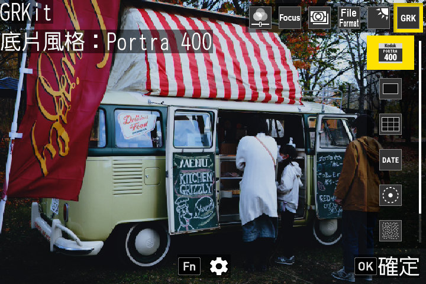
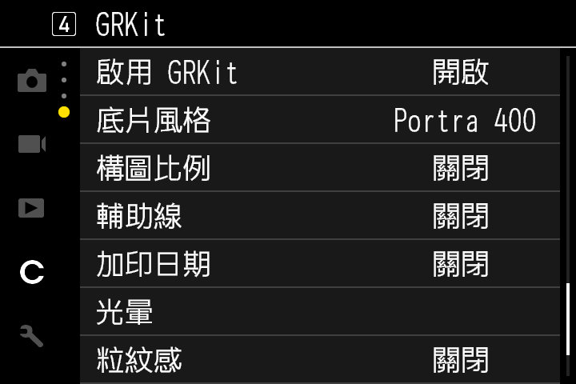

# GRKit

[English](README.md) | [简体中文](README.zh-Hans.md) | 繁體中文 | [日本語](README.ja.md) | [한국어](README.ko.md)

[](https://github.com/ahonn/grkit/actions/workflows/tests.yml)
[](LICENSE)

GRKit 為理光 GR III、GR IIIx 與 GR IV 加上底片濾鏡、XPan 等畫面比例、日期浮水印、光暈與顆粒，從記憶卡執行，不改韌體。拔出記憶卡，相機就恢復原狀。

<p>
  
  
</p>

照片：[MIKI Yoshihito](https://www.flickr.com/photos/mujitra/53311001084/)，[CC BY 2.0](https://creativecommons.org/licenses/by/2.0/)。

## 功能

拍攝時按下 ADJ 撥桿，選擇第 6 項 GRK。

- **底片風格**：Portra 400、Velvia 100、Tri-X 400 等，取景時即時預覽。也可以在 [grkit.app](https://grkit.app) 匯入自己的 `.cube` LUT 或 Lightroom 預設集。風格由開源底片 LUT 擬合而成，效果接近原 LUT，但不完全相同（[來源](effects/NOTICE.md)）。
- **構圖比例**：XPan、2.35:1、16:9、4:3、5:4、7:6 與 1:1。可裁切 JPEG，也可僅輔助構圖，取景時以遮罩或框線標出範圍。兩種模式下，選擇比例都會把相機設為 3:2。關閉構圖比例時保留相機目前的比例。

  RAW 的預設裁切範圍保持原生 3:2，並保留相機的數位裁切設定。內嵌預覽仍可能顯示所選構圖。

- **輔助線**：三分法、中心、黃金分割與對角線。
- **加印日期**：在照片上印日期，有經典、GR1s 點陣與 GR II 三種樣式。
- **光暈**：柔光讓燈光和高光向周圍柔和擴散。底片光暈在明亮光源周圍形成橙紅色光暈，模擬電影底片效果。兩項各有「啟用」和「強度」設定，可同時開啟。
- **粒紋感**：弱、中、強、特強四段，粒紋大小可選自動、小、中、大。

開機後 GRKit 需要約 8 到 10 秒載入，GR IV 以及安裝或更新後的第一次開機會更久。在這之前相機使用原本的設定。完整設定在 MENU 自訂頁最後的 GRKit 小節。想自己寫模組，請見 [Writing a module](docs/modules.md)（英文）。

**快速啟動**：使用選用的[快速啟動韌體](resources/FASTBOOT.zh-Hant.md)，同一個 GRKit 安裝包在開機後很快就能載入。它在 grkit.app 的[快速啟動頁面](https://grkit.app/zh-hant/fastboot/)上以 Ricoh 官方韌體製作，以韌體更新的方式安裝。GRKit 本身從不寫入韌體。

## 支援機型

| 機型 | 實機測試 | 已支援 |
| --- | --- | --- |
| GR III、GR III HDF | 2.10、2.20 | 2.21 |
| GR IIIx、GR IIIx HDF | 1.60、1.70 | 1.71 |
| GR IV、GR IV HDF | 1.11、1.20 | 1.21 |
| GR IV Monochrome | 1.00 | 1.10、1.11 |

GR IV Monochrome 不含底片風格。其他機型與韌體版本目前不支援。如果 GRKit 在支援的相機上無法載入，請參考[韌體匯出指南](resources/DUMP.zh-Hant.md)。

> [!WARNING]
> GRKit 仍是實驗性專案，使用風險請自行承擔。
> 安裝時會開啟相機的 SD 腳本設定，之後需要手動關閉。如果 GRKit 出錯，相機可能卡在開機階段，安裝前請先閱讀[復原指南](resources/RECOVERY.zh-Hant.md)。

## 安裝

在 [grkit.app](https://grkit.app) 選好相機、模組和效果，再選擇一種方式：

- **直接寫入 SD 卡**：在電腦上用 Chrome 或 Edge 操作。之後要更新、解除安裝或增減模組和效果，也都在網站上完成。
- **下載 GRKit.zip**：依照壓縮檔內的 PDF 指南操作（[GR III 與 GR IIIx](resources/INSTALLATION.zh-Hant.md)、[GR IV](resources/INSTALLATION-GR4.zh-Hant.md)）。

只有第一次需要按住 MENU 開機。用 ZIP 更新時，替換卡中的 `SCRIPT` 資料夾即可，設定會保留在 `GRKIT` 裡。格式化記憶卡會刪除 GRKit，格式化前請先把 `GRKIT` 備份到電腦。

GRK 沒有出現時，先看 [grkit.app](https://grkit.app) 上的常見問題。如果還是不行，請提交[裝置回報](https://github.com/ahonn/grkit/issues/new?template=device-report.yml)，並附上 `GRKIT/REPORT.TXT`、`GRKIT/BOOT.TXT` 和 `SCRIPT/GRKIT/INSTALL.ERR`（如果有）。

## 從原始碼建置

需要 Rust 1.92 以上版本、支援 ARM 的 Clang 與 LLD，以及理光官方韌體檔案（儲存庫不含韌體）。

```sh
cargo install --path crates/grkit-cli --locked
grkit effects build --source effects --out build/effects
grkit build --target gr3-2.10 --firmware firmware/fwdc239b.bin --out build/runtime
for module in modules/*/; do grkit module build --dir "$module" --out "build/modules/$(basename "$module").GRM"; done
sh .github/scripts/install-guide-tools.sh build/guide-tools
sh .github/scripts/build-guides.sh grkit build/guide-tools build/guides
grkit package --build build/runtime --effects build/effects $(for m in build/modules/*.GRM; do printf -- '--module %s ' "$m"; done) \
  --guide build/guides/gr3/en.pdf --out dist/GRKit.zip
grkit verify dist/GRKit.zip
```

其他機型、部分模組或其他語言的指南，請見 [Build packages](CONTRIBUTING.md#build-packages)（英文）。

## 參與貢獻

請見 [CONTRIBUTING.md](CONTRIBUTING.md)（英文）。不論能不能用，都歡迎提交裝置回報，尤其是還沒經過實機測試的韌體。遇到問題或有疑問，可以填寫[問題回報表單](https://tally.so/r/Z9jRgB)；想提功能建議或為現有建議投票，可以到[功能建議看板](https://grkit.userjot.com)。也歡迎[請我喝杯咖啡](https://buymeacoffee.com/yuexunjiang)支持這個專案。

## 文件（英文）

- [架構](docs/architecture.md)
- [撰寫模組](docs/modules.md)與[模組參考](docs/module-reference.md)
- [快速啟動韌體](docs/fastboot.md)：供 SD 腳本使用的介面
- [發布流程](docs/releasing.md)
- [效果](effects/README.md)
- [網站](web/README.md)

## 授權

程式碼採用 [MIT 授權條款](LICENSE)。每個安裝包都附有 `LICENSES.md`，列出包內檔案的授權。

- 效果採用 CC BY-SA 4.0 或 MIT 授權，詳見 [effects/NOTICE.md](effects/NOTICE.md)。
- 選單與取景畫面的文字使用 [Roboto Condensed](https://github.com/googlefonts/roboto-classic) 字型，採用 [SIL Open Font License 1.1](crates/grkit-core/assets/RobotoCondensed-LICENSE.txt)。
- 效果擬合方法移植自 [gr3-film-mods](https://github.com/idontknownihil/gr3-film-mods)，採用 [MIT 授權條款](crates/grkit-core/GR3_FILM_MODS_LICENSE.txt)。

RICOH 與 GR 是 Ricoh Company, Ltd. 的商標，底片名稱是各自所有者的商標。GRKit 是獨立專案，與理光及任何底片廠商皆無關聯。
