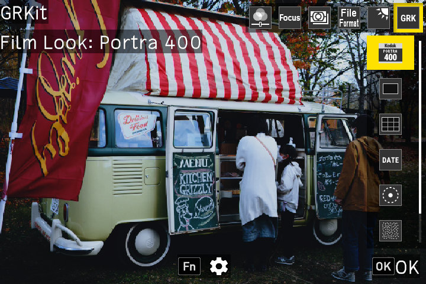

# GRKit

RICOH GR III および GR III HDF ファームウェア 2.10 専用です。

GRKit は試験的なソフトウェアで、保証はありません。GRKit に問題があると、カメラが起動中に止まることがあります。インストール前に[復旧ガイド](https://github.com/ahonn/grkit/blob/main/resources/RECOVERY.ja.md)をお読みください。GRKit をインストールした時点で、[利用規約](https://github.com/ahonn/grkit/blob/main/resources/TERMS.ja.md)に同意したものとみなされます。

## インストール

パソコンの Chrome か Edge で [grkit.app](https://grkit.app/ja/) を開くと、カードリーダーのカードに GRKit を直接書き込めます。手順 2 の代わりになります。

1. カメラの電源を切ります。
2. `SD_ROOT` の中身（フォルダー自体ではありません）をメモリーカードのルートにコピーします。コピー後、ルートに `SCRIPT` フォルダーがあることを確認します。
3. カードを入れます。MENU ボタンを押したまま電源を入れ、電源が自動で切れるまで待ちます。
4. 通常どおり電源を入れます。

手順 3 で、カメラの SD スクリプトがオンになります。カメラに Mode Set Command と Complete が表示され、電源が自動で切れます。SD スクリプトがすでにオンの場合は、手順 3 を省略します。

インストール後は、カードのルートから `00078350.588` と `DEVELOP.MOD` を削除できます。

## 使い方

電源を入れて数秒後、撮影画面の上部に **GRKit** が表示されたら読み込み完了です。インストールやアップデート後の最初の起動では少し時間がかかります。読み込みが終わる前に撮った写真には、GRKit の効果は付きません。撮影モードで ADJ レバーを押し込み、6 番目の項目 GRK を選びます。

写真：[MIKI Yoshihito](https://www.flickr.com/photos/mujitra/53311001084/)、[CC BY 2.0](https://creativecommons.org/licenses/by/2.0/)。

- **フィルムルック：** エフェクトにカーソルを合わせると撮影画面でプレビューでき、OK で確定します。Fn でそのエフェクトを調整します。カメラのイメージコントロールの設定は変わりません。
- **フレーミング：** XPan、2.35:1、16:9 などの比率です。JPEG 写真を切り抜き、DNG は 3:2 のままです。Fn で構図ガイドのみに切り替えたり、マスクを設定したりできます。
- **構図ガイド：** 線は撮影画面にだけ表示され、写真には入りません。
- **日付入れ撮影：** 写真の右下に日付を入れます。Fn で日付のスタイルと書体を選びます。
- **グロー：** ブルームとハレーションです。JPEG 写真にのみ適用され、撮影画面には反映されません。
- **粒状感：** 写真に粒状感を加えます。Fn で粒子の大きさを選びます。

すべての設定は、MENU のカスタマイズタブ（C）の最後にある **GRKit** にもあります。モジュールごとに行があり、モジュールのオン・オフ、ADJ に表示するエフェクト・比率・スタイルの選択（**オプション**）、並び順（**ADJ メニューの順番**）を設定できます。設定は電源を切っても保持されます。

## アップデート

パソコンの Chrome か Edge で [grkit.app](https://grkit.app/ja/) を開くと、カードリーダーのカードを直接アップデートできます。手順 2 と 3 の代わりになります。

1. カメラの電源を切ります。
2. カードから `SCRIPT` フォルダーを削除します。
3. 新しいパッケージの `SD_ROOT` にある `SCRIPT` フォルダーを SD カードのルートにコピーします。
4. カメラを通常どおり起動します。MENU を押す必要はありません。

設定とエフェクトは `GRKIT` フォルダーに保存されるので、アップデート後も残ります。GRKit 1.2 からアップデートする場合は、設定とエフェクトを引き継ぐため、grkit.app でアップデートしてください。

## 高速起動（オプション）

公式ファームウェアでは、GRKit はカメラがカードを読み終えるまで待つため、読み込まれるのは電源を入れてから約 8〜10 秒後です。高速起動ファームウェアを入れると、電源を入れて 1〜2 秒で読み込まれます。同じパッケージをどちらのファームウェアでも使えます。高速起動ファームウェアを入れなくても、GRKit の機能は同じです。

高速起動ファームウェアは、grkit.app の[高速起動のページ](https://grkit.app/ja/fastboot/)で作ります。Ricoh からダウンロードした公式ファームウェアを選ぶとページが作成するので、公式ファームウェアの更新と同じ方法でインストールします。インストールにはファームウェアの更新が必要で、更新が途中で止まるとカメラが起動しなくなるおそれがあります。元に戻すには、同じバージョンの公式ファームウェアをインストールします。

## トラブルシューティング

### MENU ボタンを押したまま電源を入れると、ファームウェアの更新が始まる

カードのルートにファームウェアのファイルがあります。カメラの電源を切り、カードのルートから `.bin` ファイルをすべて削除してから、インストールの手順 3 をやり直します。

### Mode Set Command が表示されない

- MENU ボタンを押したまま電源を入れます。
- `SD_ROOT` の中身は、`DCIM` などのフォルダーではなく、カードのルートにコピーします。

### ADJ モードに GRK が表示されない

1. 電源を入れて、撮影画面の上部に **GRKit** が表示されるまで数秒待ちます。
2. カードのルートに `SCRIPT` フォルダーがあることを確認します。
3. カードに `SCRIPT/GRKIT/INSTALL.ERR` がある場合は、カメラのメニューで、パッケージがカメラのファームウェアのバージョンに合っていることを確認します。合っている場合は、`INSTALL.ERR`、`GRKIT/REPORT.TXT`、`GRKIT/BOOT.TXT`（ある場合）を添えて[デバイスレポート](https://github.com/ahonn/grkit/issues/new?template=device-report.yml)を送ってください。
4. GRKit は Ricoh の公式ファームウェアと grkit.app の高速起動ファームウェアでのみ動作します。

### カードをフォーマットした後、GRKit が動かない

フォーマットすると、GRKit とその設定が削除されます。フォーマットの前に `GRKIT` フォルダーをパソコンにコピーします。フォーマットの後、`SD_ROOT` の中身をもう一度コピーし、`GRKIT` フォルダーをカードのルートに戻します。

## GRKit の削除

パソコンの Chrome か Edge で [grkit.app](https://grkit.app/ja/) を開くと、カードリーダーのカードから GRKit を直接削除でき、SD スクリプトもオフにできます。

カメラの電源を切り、カードから `SCRIPT` フォルダーと `GRKIT` フォルダーを削除します。

SD スクリプトの設定はオンのままです。オフにするには：

1. https://grkit.app で、お使いのカメラの SD スクリプトをオフにするファイルをダウンロードします。
2. `SD_ROOT` の中身をカードのルートにコピーします。
3. カードを入れます。MENU ボタンを押したまま電源を入れ、電源が自動で切れるまで待ちます。
4. カードのルートから `00078350.588` と `DEVELOP.MOD` を削除します。

起動の途中でカメラが止まった場合は、[復旧ガイド](https://github.com/ahonn/grkit/blob/main/resources/RECOVERY.ja.md)を参照してください。

GRKit は Ricoh と提携していません。ソースコードとライセンス：https://github.com/ahonn/grkit
