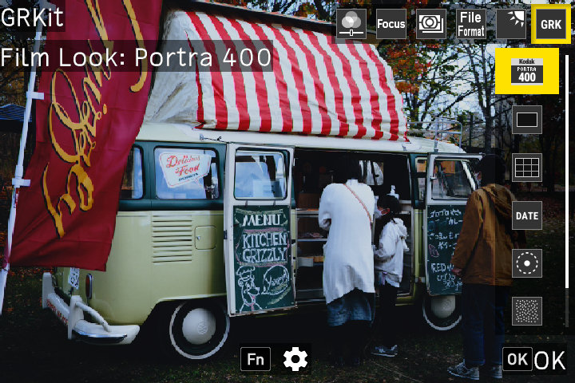

# GRKit

RICOH GR III 및 GR III HDF 펌웨어 2.10 전용입니다.

GRKit은 실험적인 소프트웨어이며, 어떠한 보증도 제공하지 않습니다. GRKit에 문제가 생기면 카메라가 시작 중에 멈출 수 있습니다. 설치 전에 [복구 가이드](https://github.com/ahonn/grkit/blob/main/resources/RECOVERY.ko.md)를 읽어 주세요. GRKit을 설치하면 [이용 약관](https://github.com/ahonn/grkit/blob/main/resources/TERMS.ko.md)에 동의한 것으로 간주됩니다.

## 설치

컴퓨터의 Chrome이나 Edge에서 [grkit.app](https://grkit.app/ko/)을 열면 카드 리더에 넣은 카드에 GRKit을 바로 쓸 수 있습니다. 2단계 대신 사용할 수 있습니다.

1. 카메라의 전원을 끕니다.
2. `SD_ROOT`의 내용(폴더 자체가 아님)을 SD 카드 최상위에 복사합니다. 복사하면 카드 최상위에 `SCRIPT` 폴더가 있어야 합니다.
3. 카드를 넣습니다. MENU 버튼을 누른 채 전원을 켜고, 카메라의 전원이 저절로 꺼질 때까지 기다립니다.
4. 평소처럼 전원을 켭니다.

3단계에서 카메라의 SD 스크립트가 켜집니다. 카메라에 Mode Set Command와 Complete가 표시된 다음, 전원이 저절로 꺼집니다. SD 스크립트가 이미 켜져 있으면 3단계를 건너뜁니다.

설치 후에는 카드 최상위에서 `00078350.588`과 `DEVELOP.MOD`를 삭제해도 됩니다.

## 사용 방법

전원을 켜고 몇 초 뒤 촬영 화면 위쪽에 **GRKit**이 표시되면 불러오기가 끝난 것입니다. 설치나 업데이트 후 처음 켤 때는 조금 더 걸립니다. 불러오기가 끝나기 전에 찍은 사진에는 GRKit 효과가 적용되지 않습니다. 촬영 모드에서 ADJ 레버를 누르고 여섯 번째 항목인 GRK를 선택합니다.

사진: [MIKI Yoshihito](https://www.flickr.com/photos/mujitra/53311001084/), [CC BY 2.0](https://creativecommons.org/licenses/by/2.0/).

- **필름 룩:** 효과에 커서를 맞추면 촬영 화면에서 미리 볼 수 있고, OK를 누르면 확정됩니다. Fn을 누르면 그 효과를 조정합니다. 카메라의 화상 컨트롤 설정은 바뀌지 않습니다.
- **프레이밍:** XPan, 2.35:1, 16:9 등의 비율입니다. JPEG 사진을 자르고, DNG는 3:2로 유지됩니다. Fn을 누르면 구도 가이드만 사용하거나 마스크를 설정할 수 있습니다.
- **구도 가이드:** 선은 촬영 화면에만 표시되고 사진에는 들어가지 않습니다.
- **날짜 각인:** 사진의 오른쪽 아래에 날짜를 넣습니다. Fn을 누르면 날짜 서식과 글꼴을 선택합니다.
- **글로우:** 블룸과 헐레이션입니다. JPEG 사진에만 적용되며 촬영 화면에는 미리 보이지 않습니다.
- **입자감:** 사진에 입자감을 더합니다. Fn을 누르면 입자 크기를 선택합니다.

모든 설정은 MENU의 사용자 설정 탭(C) 마지막에 있는 **GRKit** 항목에도 있습니다. 모듈마다 행이 있으며, 모듈을 켜거나 끄고, **옵션**에서 ADJ에 표시할 효과·비율·종류를 고르고, **ADJ 메뉴 순서**에서 순서를 바꿀 수 있습니다. 설정은 전원을 꺼도 유지됩니다.

## 업데이트

컴퓨터의 Chrome이나 Edge에서 [grkit.app](https://grkit.app/ko/)을 열면 카드 리더에 넣은 카드를 바로 업데이트할 수 있습니다. 2단계와 3단계 대신 사용할 수 있습니다.

1. 카메라의 전원을 끕니다.
2. 카드에서 `SCRIPT` 폴더를 삭제합니다.
3. 새 패키지의 `SD_ROOT`에 있는 `SCRIPT` 폴더를 SD 카드 최상위에 복사합니다.
4. 평소처럼 전원을 켭니다. MENU 버튼을 누를 필요는 없습니다.

설정과 효과는 `GRKIT` 폴더에 저장되므로 업데이트 후에도 남습니다. GRKit 1.2에서 업데이트할 때는 설정과 효과를 유지하도록 grkit.app에서 업데이트하세요.

## 빠른 시작(선택 사항)

공식 펌웨어에서는 GRKit이 카메라가 카드를 다 읽을 때까지 기다리므로, 전원을 켜고 약 8~10초 뒤에 불러와집니다. 빠른 시작 펌웨어를 설치하면 전원을 켜고 1~2초 만에 불러와집니다. 같은 패키지를 두 펌웨어 모두에서 쓸 수 있습니다. 빠른 시작 펌웨어를 설치하지 않아도 GRKit의 기능은 같습니다.

빠른 시작 펌웨어는 grkit.app의 [빠른 시작 페이지](https://grkit.app/ko/fastboot/)에서 만듭니다. Ricoh에서 내려받은 공식 펌웨어를 선택하면 페이지가 빠른 시작 펌웨어를 만들며, 공식 펌웨어 업데이트와 같은 방법으로 설치합니다. 설치하려면 카메라 펌웨어를 업데이트해야 하며, 업데이트가 중간에 멈추면 카메라가 켜지지 않을 수 있습니다. 되돌리려면 같은 버전의 공식 펌웨어를 설치합니다.

## 문제 해결

### MENU 버튼을 누른 채 전원을 켜면 펌웨어 업데이트가 시작됩니다

카드 최상위에 펌웨어 파일이 있습니다. 카메라의 전원을 끄고 카드 최상위의 `.bin` 파일을 모두 삭제한 다음, 설치 3단계를 다시 합니다.

### Mode Set Command가 표시되지 않습니다

- MENU 버튼을 누른 채 전원을 켭니다.
- `SD_ROOT`의 내용은 `DCIM` 같은 폴더가 아니라 카드 최상위에 복사합니다.

### ADJ 모드에 GRK가 표시되지 않습니다

1. 전원을 켜고 촬영 화면 위쪽에 **GRKit**이 표시될 때까지 몇 초 기다립니다.
2. 카드 최상위에 `SCRIPT` 폴더가 있는지 확인합니다.
3. 카드에 `SCRIPT/GRKIT/INSTALL.ERR`가 있으면 카메라 메뉴에서 패키지가 카메라의 펌웨어 버전에 맞는지 확인합니다. 맞다면 `INSTALL.ERR`, `GRKIT/REPORT.TXT`, `GRKIT/BOOT.TXT`(있는 경우)를 첨부해 [기기 보고서](https://github.com/ahonn/grkit/issues/new?template=device-report.yml)를 보내 주세요.
4. GRKit은 Ricoh 공식 펌웨어와 grkit.app의 빠른 시작 펌웨어에서만 작동합니다.

### 카드를 포맷한 뒤 GRKit이 작동하지 않습니다

포맷하면 GRKit과 그 설정이 삭제됩니다. 포맷하기 전에 `GRKIT` 폴더를 컴퓨터에 복사합니다. 포맷한 뒤 `SD_ROOT`의 내용을 다시 복사하고, `GRKIT` 폴더를 카드 최상위에 다시 복사합니다.

## GRKit 삭제

컴퓨터의 Chrome이나 Edge에서 [grkit.app](https://grkit.app/ko/)을 열면 카드 리더에 넣은 카드에서 GRKit을 바로 삭제하고, SD 스크립트도 끌 수 있습니다.

카메라의 전원을 끄고 카드에서 `SCRIPT` 폴더와 `GRKIT` 폴더를 삭제합니다.

SD 스크립트 설정은 켜진 채로 남습니다. 끄려면:

1. https://grkit.app에서 카메라에 맞는 SD 스크립트 끄기 파일을 내려받습니다.
2. `SD_ROOT`의 내용을 SD 카드 최상위에 복사합니다.
3. 카드를 넣습니다. MENU 버튼을 누른 채 전원을 켜고, 카메라의 전원이 저절로 꺼질 때까지 기다립니다.
4. 카드 최상위에서 `00078350.588`과 `DEVELOP.MOD`를 삭제합니다.

카메라가 시작 중에 멈추면 [복구 가이드](https://github.com/ahonn/grkit/blob/main/resources/RECOVERY.ko.md)를 참고하세요.

GRKit은 Ricoh와 관계가 없습니다. 소스 코드와 라이선스: https://github.com/ahonn/grkit
