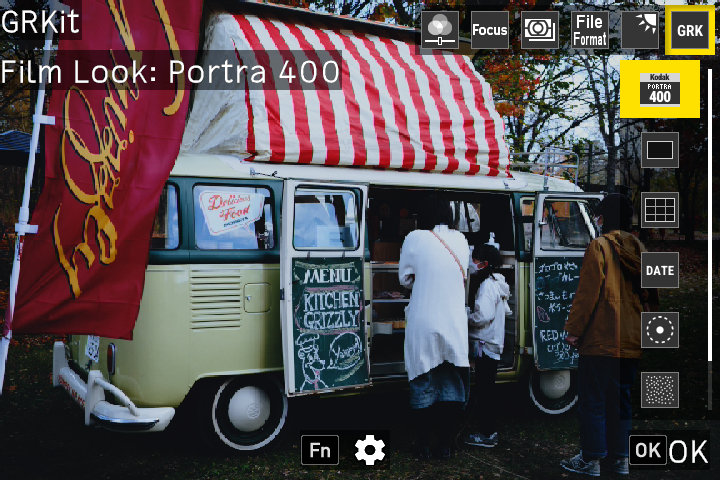

# GRKit

For RICOH GR III and GR III HDF firmware 2.10 only.

GRKit is experimental and has no warranty. If GRKit fails, the camera can stop during startup. Read the [recovery guide](https://github.com/ahonn/grkit/blob/main/resources/RECOVERY.md) before you install. When you install GRKit, you accept the [terms of use](https://github.com/ahonn/grkit/blob/main/resources/TERMS.md).

## Install

1. Turn the camera off.
2. Copy the contents of `SD_ROOT` to the root of the SD card.
3. Insert the card. Hold MENU while you turn the camera on. Wait until the camera turns itself off.
4. Turn the camera on normally.

Step 3 turns on the camera's SD scripts. The camera shows Mode Set Command, then Complete, and then turns itself off.

If the SD scripts are already on, skip step 3.
After the installation, you can remove `00078350.588` and `DEVELOP.MOD` from the card root. This step is optional.

## Update

1. Turn the camera off.
2. Delete the `SCRIPT` folder from the card.
3. Copy the `SCRIPT` folder of `SD_ROOT` of the new package to the root of the SD card.
4. Turn the camera on normally. You do not need to hold MENU.

GRKit keeps your settings, your effects, and the modules that you added in the `GRKIT` folder, so the update keeps them.

Deleting `SCRIPT` also deletes the settings and the effects of GRKit 1.2. To keep them, update on [grkit.app](https://grkit.app) in Chrome or Edge on a computer, with the card in a card reader.

## Use

Open ADJ and select the sixth entry, GRK. GRKit loads a few seconds after power-on, so the entry can appear late. When GRKit has loaded, the shooting screen shows **GRKit** at the top for a few seconds. This label needs the Framing or Guides module.

Photo: [Snow in Akihabara](https://www.flickr.com/photos/cafetricot/51803682755/) by nagi usano, [CC BY 2.0](https://creativecommons.org/licenses/by/2.0/).

- **Film Look:** highlight an effect to preview it. Press OK to keep it. Press Fn to adjust the Standard parameters of the effect. On the GRK menu, press Fn on the Film Look row to adjust the selected effect. Each effect keeps its own adjustments, and they do not change the camera's Image Control settings.
- **Framing:** select XPan, 2.35:1, 16:9, 4:3, 5:4, 7:6, or 1:1. Press Fn to set **Mode** to **Crop** or **Guides Only**.

The default **Crop** mode keeps the existing behavior. Selecting a ratio sets the camera's aspect ratio to 3:2 and crops JPEG photos. DNG files keep the full sensor data and record a default crop. RAW software that applies this crop initially shows only the selected area. Selecting another native aspect ratio pauses cropping.

In **Guides Only** mode, the live view shows the selected ratio for composition. It does not change the camera's aspect ratio, JPEG dimensions, or RAW crop settings. The frame appears only with the camera's native 3:2 aspect ratio. Other native ratios hide the frame.

The **Mask** setting selects Dark, Black, or Frame Lines in either mode. Frame Lines alone does not disable cropping. Changing Mode keeps the Mask setting.

- **Guides:** select a guide style. Press Fn to set the color, the opacity, and whether the lines also show while DISP hides the shooting information. The lines show only in the viewfinder. Guides follow the actual photo area, including native aspect ratios. In Guides Only mode, they follow the native photo area, not the composition frame.
- **Date Imprint:** select a date style. Press Fn to set **Date Style** and **Date Font**, the digits: Classic, GR1s, or GR II. Photos get the date at the bottom right. While it is on, the viewfinder shows DATE with the full shooting information.
- **Glow:** Bloom spreads light around highlights, while Halation adds a red-orange film halo. In ADJ, open Glow and select Bloom or Halation. Press OK to toggle the effect, or Fn to open its Enable and Strength settings. MENU opens the same settings. Each effect starts disabled at Medium strength, which you can set to Weak, Medium, or Strong. Disabling an effect keeps its strength. The effects apply only to JPEG photos, with no live-view preview.
- **Grain:** select Weak, Medium, Strong, or Extra Strong. Press Fn to set **Size**: Auto (by ISO), Small, Medium, or Large. Only photos get the grain.

Press MENU to go back one level. GRKit keeps your settings after power-off.

All the settings of GRKit are also in the **GRKit** section at the end of the Customize tab (C) of MENU:

- Each module has a row. Its first setting, **Enable**, turns the module on or off at once. A module that is off leaves ADJ, while the Off value of a module, such as Off in Framing, keeps it in ADJ. Its other settings follow. Film Look has **Film Stock**, which selects the effect, and the **Parameters** of the selected effect.
- Film Look, Framing, Guides, and Date Imprint have an **Options** row after **Enable**. It lists the effects, ratios, guide styles, or date styles. Each value has a checkbox. Press OK on one to check or clear it. ADJ shows only the values that are on.
- **ADJ Order** sets the order of the modules in GRK. Select a module, then its new position. The new order applies at once.
- **About GRKit** shows the GRKit version and the project address.

`GRKIT/REPORT.TXT` gives the GRKit version.

GRKit keeps the effects in the `GRKIT/EFFECTS` folder. A new package adds its effects there and replaces their earlier versions. It does not remove other effects. To add an effect, copy its file into `GRKIT/EFFECTS`. To add an effect of another package, copy its file from `SD_ROOT/SCRIPT/GRKIT/EFFECTS` of that package into `GRKIT/EFFECTS`. Do not copy an effect into `SCRIPT/GRKIT/EFFECTS`: GRKit reads that folder only at the first power-on after an installation or an update. To remove one, turn the camera off and delete its file. A later package adds it again only when its file in the package changes. To add a module, copy its file into `GRKIT/MODULES`. **Options** of Film Look in the GRKit section of MENU lists each effect file and turns it on or off in Film Look at once. GRKit installs at most 40 effects, first those that are on. If you turn on an effect that did not install, it shows at the next power-on. `GRKIT/REPORT.TXT` lists the modules and the effects of the last power-on, and the reason when a module did not load.

## Troubleshooting

### The camera starts a firmware update when you hold MENU

The card root has a firmware update file. Turn the camera off. Remove each `.bin` file from the card root. Then do step 3 again.

### The camera does not show Mode Set Command

- Hold MENU, then turn the camera on. If you press MENU after the camera is on, the SD scripts stay off.
- Copy the contents of `SD_ROOT` to the card root, not into `DCIM` or another folder.

### GRK does not show in ADJ

1. Wait a few seconds after power-on. GRKit loads after the camera starts. When it has loaded, the shooting screen shows **GRKit** at the top for a few seconds.
2. Look for GRK in ADJ. The GRKit settings are also in the GRKit section of the Customize tab of MENU.
3. If the camera did not show Mode Set Command in step 3, do step 3 again.
4. Make sure that the card root has the `SCRIPT` folder. Copy all the contents of `SD_ROOT`, including `SCRIPT`.
5. If the card has `SCRIPT/GRKIT/INSTALL.ERR`, GRKit did not install. Make sure that the package is for the firmware version of your camera. To see the firmware version, open the camera menu. If the version is correct, send a [device report](https://github.com/ahonn/grkit/issues/new?template=device-report.yml) with all the lines of `INSTALL.ERR`, `GRKIT/REPORT.TXT`, and `GRKIT/BOOT.TXT`.
6. GRKit runs only on the official Ricoh firmware. It does not run on modified firmware.

### GRKit stops working after you format the card

A format of the card, in the camera or on a computer, deletes the `SCRIPT` and `GRKIT` folders. This removes GRKit, your GRKit settings, and your effects.

1. Before you format the card, copy the `GRKIT` folder to a computer.
2. After the format, copy the contents of `SD_ROOT` to the card root again.
3. Copy your `GRKIT` folder back to the card root.

### GRKit starts in safe mode

In safe mode, GRKit loads no module, and `GRKIT/REPORT.TXT` says why. Safe mode starts when the `GRKIT` folder has a file named `SAFE` or `SAFE.TXT`. To load the modules again, delete the file.

If the camera stops after you added a module, set **Enable** of that module to Off in the GRKit section of the Customize tab of MENU. If the camera stops before you can open MENU, remove the card. On a computer, delete the module from `GRKIT/MODULES`, or put an empty file named `SAFE` or `SAFE.TXT` in the `GRKIT` folder.

## Remove or recover

To remove GRKit, turn the camera off. Then delete the `SCRIPT` and `GRKIT` folders from the card. `GRKIT` holds your GRKit settings.

The SD script setting stays on. To turn it off:

1. On https://grkit.app, download the files that turn SD scripts off for your camera. The button is below the installation steps.
2. Copy the contents of `SD_ROOT` to the root of the SD card.
3. Insert the card. Hold MENU while you turn the camera on. Wait until the camera turns itself off.
4. Remove `00078350.588` and `DEVELOP.MOD` from the card root.

If the camera stops during startup, remove the battery and the card. Then start the camera without the card. If it still does not start, see the [recovery guide](https://github.com/ahonn/grkit/blob/main/resources/RECOVERY.md).

GRKit is not affiliated with Ricoh. Source code and licenses: https://github.com/ahonn/grkit
